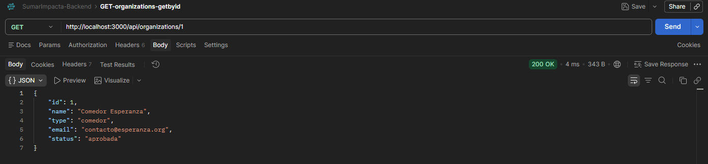

# SumarImpacto Backend - Grupo A13

Proyecto académico desarrollado para la materia **Desarrollo de Sistemas Web Back End**
del **IFTS N° 29 - 2do Cuatrimestre 2026**.

## Sobre el proyecto

**SumarImpacto** es una asociación civil sin fines de lucro orientada a vincular
organizaciones sociales con donantes interesados en financiar proyectos de impacto social.

El sistema busca facilitar la gestión de campañas, fondos y rendiciones, haciendo
especial énfasis en la **trazabilidad y transparencia del uso de los recursos**.

## Objetivo

Desarrollar el backend del sistema mediante una **API REST** y vistas web, aplicando
los conceptos trabajados durante la cursada.

## Estado actual

El proyecto está en la **segunda entrega**. Respecto de la primera:

- la persistencia pasó de archivos JSON a **MongoDB local** con **Mongoose**;
- el backend pasó de CommonJS a **ES Modules** (`import` / `export`);
- los controllers son **asincrónicos** (`async` / `await`);
- se agregaron pantallas de gestión que consumen la API con **`fetch()`**;
- el `DELETE` pasó a ser **borrado lógico**;
- se agregaron **usuarios** con contraseña hasheada (módulo `crypto` de Node), **roles**
  y **login**.

Lo que queda fuera de esta entrega está en [Desarrollo futuro](#desarrollo-futuro).

## Prueba rápida

La base de datos es **MongoDB local**: no hay una base compartida en la nube, así que
cada persona que prueba el proyecto necesita su propio servidor MongoDB y cargar los
datos de ejemplo. Los pasos, en orden (el detalle de cada uno está más abajo):

1. Node.js 20.19 o superior y `npm install`.
2. MongoDB Community Server instalado y en ejecución ([Instalación § 3](#3-mongodb-community-server-local)).
3. Copiar `.env.example` como `.env` (los valores por defecto apuntan a MongoDB local).
4. Cargar los datos de ejemplo: `npm run seed -- --confirm-db=sumarimpacto`.
5. Verificar con `npm test` (99 pruebas) y levantar con `npm run dev`.
6. Abrir <http://localhost:3000>. En **Ingresar** se puede probar el login con
   `superadmin` / `superadmin` (ver [Usuarios de prueba](#usuarios-de-prueba)).

## Tecnologías

- JavaScript con **ES Modules**
- **Node.js** (versión 20.19 o superior)
- **Express 5**
- **Pug** (vistas HTML)
- **`fetch()`** en el navegador (sin frameworks de frontend)
- **MongoDB Community Server** (local) y **Mongoose**
- **dotenv** (variables de entorno)
- módulo **`crypto`** de Node (hash de contraseñas con PBKDF2, sin dependencias externas)
- `node:test` y `node:assert/strict` (testing, sin dependencias externas)
- Nodemon (desarrollo)

## Arquitectura

El proyecto sigue el patrón **MVC**:

```text
Router  →  Middleware de validación  →  Controller  →  Model (Mongoose)  →  MongoDB
                                             ↓
                         respuesta JSON (API) o vista Pug (HTML)
```

- **Routes** (`routes/`): definen las URLs y qué middlewares y controller atienden cada una.
- **Middlewares** (`middlewares/`): validan `:id`, body y query antes de llegar al
  controller; `errors.js` centraliza los errores.
- **Controllers** (`controllers/`): traducen entre HTTP y el Model. Son `async` y
  delegan los errores con `next(err)`.
- **Models** (`models/`): schemas de Mongoose y reglas de negocio. Es la única capa
  que accede a la base de datos.
- **Views** (`views/`): páginas Pug. El JavaScript del navegador está en `public/js/`.

La **API** (`/api/...`) responde siempre JSON y las **vistas** (`/`, `/login`,
`/organizations`, `/campaigns`, `/users`) responden HTML.

## Estructura de carpetas

```text
├── config/
│   └── db.js                  # conexión a MongoDB (conectarDB)
├── controllers/               # organizations, campaigns, users, auth y views
├── data/                      # datos de ejemplo que carga el seed
├── docs/images/               # capturas
├── middlewares/               # validateId, validateBody, validateQuery, errors
├── models/                    # Organization, Campaign y User (Mongoose)
├── public/js/                 # JavaScript del navegador (fetch)
├── routes/                    # rutas de la API y de las vistas
├── scripts/
│   └── seed.js                # carga de datos de ejemplo
├── tests/                     # pruebas automatizadas
├── utils/                     # norm.js, objectId.js y softDelete.js (borrado lógico)
├── views/                     # plantillas Pug
├── .env.example               # plantilla de variables de entorno
└── index.js                   # punto de entrada
```

## Instalación

### 1. Node.js

Se necesita **Node.js 20.19 o superior** (lo exige Mongoose 9). Para verificar la versión:

```bash
node -v
```

### 2. Dependencias

```bash
npm install
```

### 3. MongoDB Community Server (local)

El proyecto usa un servidor **MongoDB local**, no un servicio en la nube.

En Windows se puede instalar de dos formas:

- Con **winget** (requiere permisos de administrador):

  ```powershell
  winget install -e --id MongoDB.Server
  ```

- Con el instalador `.msi` de <https://www.mongodb.com/try/download/community>,
  eligiendo **Complete** y dejando marcada la opción **Install MongoD as a Service**.

En ambos casos MongoDB queda instalado como **servicio de Windows** y se inicia solo.
Para comprobar que está funcionando:

```powershell
Get-Service MongoDB
```

El estado debe ser `Running`. El servidor escucha en `127.0.0.1:27017`. Si el servicio
está detenido, se inicia con `Start-Service MongoDB` en una terminal de administrador.

### 4. Variables de entorno (`.env`)

Copiar la plantilla:

```powershell
Copy-Item .env.example .env
```

Contenido de `.env.example`:

```env
PORT=3000
MONGO_URI=mongodb://127.0.0.1:27017/sumarimpacto
```

- `PORT` es opcional (por defecto `3000`).
- `MONGO_URI` indica el servidor y la base (`sumarimpacto`). MongoDB crea la base
  con la primera escritura.

El archivo `.env` no se sube a Git (está en `.gitignore`): cada integrante tiene el suyo.

## Cómo ejecutar el proyecto

Modo desarrollo (Nodemon reinicia el servidor al modificar archivos):

```bash
npm run dev
```

Sin Nodemon:

```bash
npm start
```

Al iniciar, el servidor **primero se conecta a MongoDB** y recién después acepta peticiones:

```text
MongoDB conectado (base: sumarimpacto)
Servidor escuchando en http://localhost:3000
```

Si falta `MONGO_URI` o MongoDB no responde, el servidor muestra el motivo y no arranca.

La base empieza vacía: para cargar los datos de ejemplo ver la sección siguiente.

## Inicialización de la base de datos con datos de ejemplo (seed)

`scripts/seed.js` carga en MongoDB las organizaciones, campañas y usuarios de ejemplo. Es una
herramienta para **inicializar los datos de ejemplo** y **no se ejecuta automáticamente**:
hay que correrlo a mano.

```bash
npm run seed -- --confirm-db=sumarimpacto
```

Cómo funciona:

1. Toma los datos de `data/organizations.json` y `data/campaigns.json` (eran la
   persistencia de la primera entrega) y de `data/users.json`. Esos archivos **sólo se
   leen**, no se modifican.
2. En los JSON las campañas apuntan a su organización con un id numérico. El script
   arma una tabla "id del JSON → ObjectId" y guarda cada campaña con el ObjectId de su
   organización, así **se conserva la relación**.
3. En una base inicialmente vacía carga **3 organizaciones, 1 campaña y 4 usuarios**.
4. **No borra ni sobrescribe** registros existentes.
5. Evita duplicados con estos criterios:
   - una organización se omite si ya existe otra con el **mismo email**;
   - una campaña se omite si su organización ya tiene una con el **mismo título**;
   - un usuario se omite si ya existe otro con el **mismo username o email**.
6. Las campañas se crean con las mismas reglas que la API: la organización debe
   existir y estar `aprobada`.
7. **Exige confirmar la base destino** con `--confirm-db`. Después de conectarse compara
   ese nombre con el de la base **realmente conectada** y, si falta o no coincide,
   termina sin escribir nada.
8. Puede ejecutarse nuevamente sin duplicar esos mismos registros, **mientras sus claves
   de identificación (email de la organización, título de la campaña, username y email
   del usuario) no cambien**. Si se modifica a mano alguna de ellas, una nueva ejecución
   volverá a crear el registro.

> **Si la base tiene usuarios creados antes del cambio de hash** (con `bcryptjs`, en
> versiones anteriores de la rama), esos usuarios no pueden entrar: el formato del hash
> cambió. Hay que borrarlos (por ejemplo, desde MongoDB Compass, la colección `users`) y
> volver a correr el seed.

Al terminar muestra un resumen:

```text
Resumen:
  Organizaciones -> creadas: 3, omitidas: 0
  Campañas       -> creadas: 1, omitidas: 0
  Usuarios       -> creados: 4, omitidos: 0
```

### Usuarios de prueba

**Credenciales ficticias, sólo para pruebas.** Las contraseñas están en
`data/users.json` sin hashear porque son datos de prueba conocidos; el seed las hashea
al cargarlas y en la base queda sólo el hash.

| Usuario | Contraseña | Rol |
| ------- | ---------- | --- |
| `superadmin` | `superadmin` | superadmin |
| `administrador` | `administrador` | administrador |
| `auditoria` | `auditoria` | auditoria |
| `organizacion` | `organizacion` | organizacion |

Se puede entrar con el usuario o con el email (`<usuario>@sumarimpacto.org`).

## API REST (JSON)

Todas las rutas de la API están bajo `/api` y responden siempre JSON.

| Método | Ruta                               | Descripción                                                     |
| ------ | ---------------------------------- | --------------------------------------------------------------- |
| GET    | `/api/organizations`               | Lista organizaciones (filtros opcionales `type` y `status`)     |
| POST   | `/api/organizations`               | Crea una organización                                           |
| GET    | `/api/organizations/:id`           | Obtiene una organización                                        |
| GET    | `/api/organizations/:id/campaigns` | Lista las campañas de una organización                          |
| PUT    | `/api/organizations/:id`           | Actualiza una organización                                      |
| DELETE | `/api/organizations/:id`           | Elimina una organización (borrado lógico)                       |
| GET    | `/api/campaigns`                   | Lista campañas (filtros opcionales `organizationId` y `status`) |
| POST   | `/api/campaigns`                   | Crea una campaña                                                |
| GET    | `/api/campaigns/:id`               | Obtiene una campaña                                             |
| PUT    | `/api/campaigns/:id`               | Actualiza una campaña                                           |
| DELETE | `/api/campaigns/:id`               | Elimina una campaña (borrado lógico)                            |
| GET    | `/api/users`                       | Lista usuarios (filtro opcional `role`)                         |
| POST   | `/api/users`                       | Crea un usuario                                                 |
| GET    | `/api/users/:id`                   | Obtiene un usuario                                              |
| PUT    | `/api/users/:id`                   | Actualiza nombre, email, rol y contraseña (no el username)      |
| DELETE | `/api/users/:id`                   | Elimina un usuario (borrado lógico)                             |
| POST   | `/api/auth/login`                  | Verifica usuario (username o email) y contraseña                |

### Usuarios y login

- **Alta** (`POST /api/users`): `username`, `name`, `email`, `password` (8 caracteres
  como mínimo) y `role` opcional. `409` si el username o el email ya existen, incluso de
  un usuario eliminado.
- **Roles**: `superadmin`, `administrador`, `auditoria`, `organizacion` (por defecto, el de
  menos permisos: `organizacion`).
- **Edición** (`PUT /api/users/:id`): nombre, email, rol y, si se manda, una contraseña
  nueva. El username es la identidad del usuario y no se modifica (`400`).
- **Regla** (`409`): no se elimina ni se degrada al último superadmin, para que el sistema
  no quede sin quien gestione usuarios.
- **Login** (`POST /api/auth/login`), con body `{ "usuario": "...", "password": "..." }`:
  `usuario` puede ser el username o el email. `200` con el usuario si coinciden; `401`
  con el mismo mensaje si el usuario no existe o la contraseña es incorrecta, para no
  revelar qué usuarios existen.
- **Alcance**: como en el ejemplo de la cátedra, el login **verifica las credenciales pero no
  crea sesión**. La API no recuerda al usuario entre pedidos, así que **las páginas y la API
  quedan abiertas** y el rol no restringe nada. La sesión queda para la entrega 3 (ver
  [Desarrollo futuro](#desarrollo-futuro)).

### Contraseñas

La contraseña nunca se guarda. Se guarda su **hash**, calculado con el módulo `crypto`
de Node, siguiendo el ejemplo de la cátedra (`models/User.js`):

- `crearPasswordSeguro(password)` genera una **sal** aleatoria de 16 bytes y calcula el
  hash con **PBKDF2** (`crypto.pbkdf2Sync`): 10000 iteraciones, 64 bytes y SHA-512. El
  usuario guarda los dos campos, `salt` y `passwordHash`. Como cada usuario tiene su
  propia sal, dos contraseñas iguales dan hashes distintos.
- `validarPassword(password)` recalcula el hash de la contraseña ingresada con la sal
  guardada y lo compara con el guardado. La comparación usa `crypto.timingSafeEqual`, que
  tarda lo mismo coincida o no, para que el tiempo de respuesta no dé pistas.
- Ninguna respuesta incluye `salt` ni `passwordHash`.

### Identificadores (ObjectId) y relación 1:N

- Los ids son **ObjectId de MongoDB**: textos de 24 caracteres hexadecimales, por
  ejemplo `6acd62652e174f7fc71872c3`. Cada base genera los suyos, así que los ids de un
  integrante no sirven en la base de otro.
- La API devuelve el id en el campo `id` (como texto), sin `_id` ni `__v`. Los
  documentos incluyen `createdAt` y `updatedAt`.
- **Relación 1:N**: una organización tiene muchas campañas. Cada campaña guarda en
  `organizationId` el ObjectId de su organización (en el schema, `ref: "Organization"`).

Ejemplo de respuesta de `GET /api/campaigns/:id` (la campaña de ejemplo cargada con el seed):

```json
{
  "id": "6acd63ad4e374c5a8a34e65e",
  "organizationId": "6acd62652e174f7fc71872c3",
  "title": "Equipamiento para comedor",
  "description": "Compra de heladeras y utensilios",
  "targetAmount": 1500000,
  "status": "activa",
  "deletedAt": null,
  "createdAt": "2026-10-12T22:48:13.963Z",
  "updatedAt": "2026-10-12T22:48:13.963Z"
}
```

### Borrado lógico

El `DELETE` no borra el documento de la base: le pone la fecha en el campo `deletedAt`
(que vale `null` mientras está vigente). Para la aplicación, lo eliminado deja de existir:

- no aparece en los listados, la página de inicio ni las búsquedas;
- `GET`, `PUT` o un segundo `DELETE` sobre algo eliminado responden `404`;
- una campaña eliminada no impide eliminar su organización.

El `status` no cambia al eliminar: es el estado de negocio y queda como estaba, para
conservar la historia. El filtro se aplica en un solo lugar, el plugin
`utils/softDelete.js`, que usan los dos modelos.

### Ejemplos de consultas

En los ejemplos, `ID_REAL_AQUI` debe sustituirse por un **ObjectId real** obtenido de la
API (por ejemplo, el campo `id` de una organización en `GET /api/organizations`):

```bash
curl -i http://localhost:3000/api/organizations
curl -i "http://localhost:3000/api/organizations?type=comedor&status=aprobada"
curl -i http://localhost:3000/api/organizations/ID_REAL_AQUI
curl -i http://localhost:3000/api/organizations/ID_REAL_AQUI/campaigns
curl -i "http://localhost:3000/api/campaigns?organizationId=ID_REAL_AQUI&status=activa"
```

Los valores de los filtros se comparan sin distinguir tildes ni mayúsculas
(`?type=fundacion` encuentra `fundación`). Un filtro con un valor no permitido responde
`400` indicando los valores válidos.

### Valores permitidos

Definidos una sola vez en los Models (`models/Organization.js`, `models/Campaign.js` y
`models/User.js`):

- **Organization `type`**: `ONG`, `fundación`, `comedor`
- **Organization `status`**: `pendiente`, `aprobada`, `suspendida`, `desvinculada` (por defecto `pendiente`)
- **Campaign `status`**: `borrador`, `activa`, `suspendida`, `cerrada` (por defecto `borrador`)
- **User `role`**: `superadmin`, `administrador`, `auditoria`, `organizacion` (por defecto `organizacion`)

### Validaciones

La validación tiene dos capas:

1. **Middlewares** (antes del controller), que arman los mensajes de error de la API:
   - `validateId.js`: el `:id` de la URL debe ser un ObjectId válido.
   - `validateBody.js`: en POST exige los campos obligatorios; en POST y PUT controla
     los tipos reales del JSON (un número enviado como texto se rechaza), los valores
     permitidos y el formato del email. Deja en el body el valor canónico (por ejemplo
     `"FUNDACION"` → `"fundación"`). Para usuarios controla además el formato del
     username, el largo mínimo de la contraseña (8) y que el username no se edite; para el
     login, que lleguen usuario y contraseña.
   - `validateQuery.js`: valida los filtros de los listados (incluido `role` en usuarios).
2. **Schemas de Mongoose** (tipos, `enum`, longitudes, formato de email, monto mayor a 0).

Campos obligatorios al crear:

- **Organization**: `name` (3 a 100 caracteres), `type`, `email`.
- **Campaign**: `title` (5 a 120 caracteres), `description`, `targetAmount` (número
  mayor a 0) y `organizationId` (ObjectId en texto).
- **User**: `username` (3 a 30 caracteres: letras, números, punto, guion o guion bajo),
  `name`, `email` y `password` (8 caracteres como mínimo).

### Errores y reglas de negocio

| Código | Cuándo |
| ------ | ------ |
| `400`  | Id, body o filtro inválidos; JSON mal formado |
| `401`  | Usuario y contraseña no coinciden (login) |
| `404`  | La ruta, la organización, la campaña o el usuario no existen; la campaña referencia una organización inexistente |
| `409`  | Se intenta crear una campaña, o moverla a otra organización, y la organización no está `aprobada` |
| `409`  | Se intenta eliminar una organización que todavía tiene campañas vigentes |
| `409`  | Username o email ya usados; eliminar o degradar al último superadmin |
| `500`  | Error inesperado (mensaje genérico, sin detalles internos) |

Las reglas de negocio están en los Models, en métodos propios:
`Campaign.crear`, `Campaign.actualizar`, `Campaign.eliminar`, `Organization.eliminar`,
`User.crear`, `User.actualizar` y `User.eliminar`.

`middlewares/errors.js` centraliza las respuestas: en la API responde JSON
(`{ "error": "..." }`) y en las vistas muestra la página `error.pug`.

## Vistas HTML (Pug) y gestión con fetch()

Estas rutas no forman parte de la API: devuelven páginas HTML.

| Ruta                 | Página |
| -------------------- | ------ |
| `/`                  | Inicio, con el listado de organizaciones y campañas |
| `/login`             | Verifica usuario (o email) y contraseña y muestra el resultado |
| `/organizations`     | Gestión de organizaciones |
| `/campaigns`         | Gestión de campañas |
| `/users`             | Gestión de usuarios |
| `/organizations/:id` | Detalle de una organización |
| `/campaigns/:id`     | Detalle de una campaña |

Las páginas de **gestión** cargan los datos desde el navegador con `fetch()` contra la
API (`public/js/organizations.js`, `public/js/campaigns.js`, `public/js/users.js` y las
funciones comunes de `public/js/comun.js`):

- listar, crear, editar y eliminar sin recargar la página;
- el mismo formulario sirve para alta y edición;
- los errores de la API (400, 404, 409) se muestran en pantalla;
- en campañas, el selector muestra todas las organizaciones con su estado; si se elige
  una que no está aprobada, la API responde `409` y se muestra el mensaje.

## Testing automatizado

Las pruebas usan el módulo nativo `node:test` con `node:assert/strict`, sin dependencias
externas. Para ejecutarlas:

```bash
npm test
```

que ejecuta `node --test`. El corredor nativo descubre solo todos los archivos
`*.test.js` del proyecto, así que una prueba nueva entra sin tocar nada.

Resultado actual:

```text
tests 99
pass 99
fail 0
```

| Archivo | Tests | Qué prueba |
| ------- | ----- | ---------- |
| `validateId.test.js` | 10 | Ids ObjectId válidos e inválidos y la delegación del error con `next(err)` |
| `validateOrganization.test.js` | 17 | Campos obligatorios, tipos, valores permitidos y normalización de organizaciones |
| `validateCampaigns.test.js` | 26 | Campos obligatorios, tipos reales, `organizationId` y valores permitidos de campañas |
| `validateUser.test.js` | 14 | Validación del alta, la edición y el filtro de usuarios, y del login |
| `reglasNegocio.test.js` | 32 | Reglas 404/409, schemas, actualizaciones parciales, filtros, borrado lógico y usuarios (hash con sal, alta, login, edición, baja y regla del último superadmin) contra MongoDB |

### Bases de desarrollo y de pruebas

En el mismo servidor MongoDB local se usan dos bases:

- **`sumarimpacto`**: desarrollo. Es la que usa la aplicación (definida en `.env`).
- **`sumarimpacto_test`**: pruebas automatizadas. `reglasNegocio.test.js` la vacía antes
  de cada prueba. Se puede cambiar con la variable de entorno `MONGO_URI_TEST`.

Protección: antes de limpiar, el test verifica el nombre de la base **realmente
conectada** y se niega a continuar si no termina en `_test`. Así nunca borra datos de
`sumarimpacto`.

Los tests de integración necesitan el servicio de MongoDB en ejecución. Si no está
disponible, **fallan** con un mensaje claro (no se omiten).

## Evidencia histórica (primera entrega)

La siguiente captura corresponde a una prueba con Postman de la **primera entrega**,
cuando la persistencia era en archivos JSON y los ids eran numéricos. **Ya no refleja
el estado actual**: hoy `GET /api/organizations/1` responde `400` porque el id debe ser
un ObjectId.

<p align="center">
  
</p>

<p align="center">
  <em>Primera entrega: GET /api/organizations/1 con Postman (ids numéricos, persistencia JSON).</em>
</p>

## Desarrollo futuro

Fuera del alcance de esta entrega:

- **Sesión de usuario y permisos por rol (entrega 3, a pedido de la cátedra).** Con sesión,
  la API reconoce al usuario en cada pedido: el login impide el acceso a quien no se
  identificó y el rol restringe qué puede hacer cada uno (por ejemplo, que sólo
  `superadmin` gestione usuarios). Hoy cualquiera puede usar las páginas de gestión y la
  API, incluso entrando por la dirección directa. Una versión con `express-session`
  quedó como referencia en la rama `sesion-entrega3`.
- **Base de datos en la nube (MongoDB Atlas, entrega 3).** Hoy la base es local: cada
  integrante y el docente tienen la suya y la cargan con el seed.
- **Requerimientos especificados en Ingeniería de Software** que todavía no están en el
  backend, como el registro de evaluación de organizaciones con motivo de rechazo.

## Grupo

**Grupo A13 - Desarrollo de Sistemas Web Back End**

## Estado

🚧 Proyecto en desarrollo (segunda entrega).
